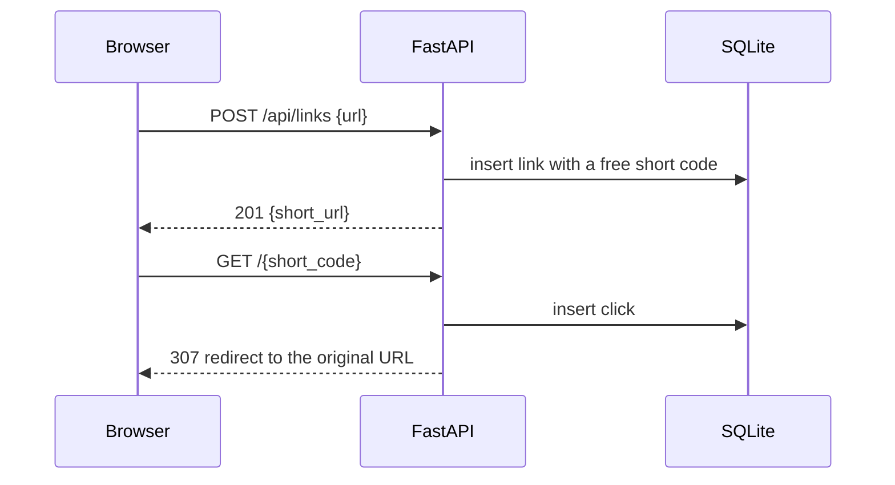

# brev

[](https://github.com/i32mumaj/brev/actions/workflows/ci.yml)
[](LICENSE)

A URL shortener that counts every click. Paste a long URL, get a 7-character link,
and see how many times it has been opened, day by day.

## Features

- Short codes derived from the URL's SHA-256, with collision handling
- Click tracking on every redirect, with a per-day chart of the last 30 days
- "Your links" history kept in the browser, with no accounts
- Per-IP rate limiting
- Light and dark themes
- One Docker image serves the frontend and the API from the same origin

## Stack

| | |
|---|---|
| Backend | Python 3.14, FastAPI, SQLAlchemy 2, Alembic, SQLite, uv |
| Frontend | React 19, TypeScript, Vite, Recharts |
| Quality | pytest, ruff, mypy (strict), vitest, oxlint, GitHub Actions |
| Deploy | Docker multi-stage build, Docker Compose |

## How it works



- **Short codes.** The code is the first 7 base62 characters of the URL's SHA-256.
  The same URL can be shortened more than once, so when a code is taken it is
  re-hashed together with the previous code until a free one turns up. If two
  requests race for the same code, the database's unique constraint rejects the
  second one and it retries.
- **"Your links".** There are no users. The browser keeps the codes it created in
  `localStorage` for 30 days and asks `/stats` for each one. Codes the backend no
  longer knows are dropped.
- **Same origin.** In production FastAPI serves the built frontend, and in
  development the Vite dev server proxies `/api` to the backend. Either way the
  frontend only uses relative paths and needs no API URL.
- **Rate limiting.** Requests are limited per client IP (IPv6 clients per /64) with a
  moving window, and the limit is checked before the route touches the database, so a
  rejected redirect never counts as a click. Over the limit the API answers `429` with
  a `Retry-After` header. Creating links is the strictest tier since it is the only one
  that grows the database. Reads stay generous because the list view fetches the stats
  of every saved link at once. Counters are kept in memory, which suits the single
  process the app runs in.

## API

Interactive docs are served at `/docs` in development. The Docker image turns them off
(`ENABLE_DOCS=false`).

| Method | Path | Description |
|---|---|---|
| `POST` | `/api/links` | Shorten a URL. Body `{"url": "..."}` → `201 {"short_url": "..."}` |
| `GET` | `/api/links/{code}` | Get one link |
| `GET` | `/api/links/{code}/stats` | Original URL, code, creation date and total clicks |
| `GET` | `/api/links/{code}/clicks?days=30` | Clicks per day, oldest first, days without clicks as 0 (`days` 1–365) |
| `DELETE` | `/api/links/{code}` | Delete a link and its clicks |
| `GET` | `/api/health` | Health check |
| `GET` | `/{code}` | Redirect to the original URL and record a click |

## Running it

### With Docker

```bash
cp .env.example .env              # optional: change the port and other settings
docker compose up -d --build      # http://localhost:8000
```

The database is stored on the `brev_data` volume and migrations run when the container
starts. To load sample data (this **erases** the database):

```bash
docker compose exec brev python -m brev.seed
```

| Variable | Default | Description |
|---|---|---|
| `PORT` | `8000` | Host port the app is published on |
| `ENABLE_DOCS` | `false` | Serve `/docs`, `/redoc` and `/openapi.json` |
| `RATE_LIMIT_CREATE` | `10/minute;100/day` | `POST /api/links` per client IP |
| `RATE_LIMIT_REDIRECT` | `60/minute` | `GET /{code}` per client IP |
| `RATE_LIMIT_API` | `300/minute` | Other `/api/links/{code}` routes per client IP |
| `CORS_ORIGINS` | empty | Comma-separated origins allowed to call the API cross-origin |
| `FORWARDED_ALLOW_IPS` | `127.0.0.1` | Proxies whose `X-Forwarded-*` headers are trusted |

Behind a reverse proxy such as nginx or Caddy, pass the original `Host` header through
and set `FORWARDED_ALLOW_IPS` so that short URLs use the public domain and scheme. Rate
limits rely on the same setting to see the real client IP instead of the proxy's.

`compose.prod.yaml` covers the case where the proxy runs in Docker on an external `web`
network: it removes the published port, trusts the proxy's headers and runs the container
read-only with all capabilities dropped and resource limits set. Enable it from `.env`:

```bash
COMPOSE_FILE=compose.yaml:compose.prod.yaml
```

The proxy then forwards to `brev:8000`. With Caddy:

```
brev.example.com {
    reverse_proxy brev:8000
}
```

### Local development

You need [uv](https://docs.astral.sh/uv/), which installs Python 3.14 for you, and Node.js 22.

```bash
# backend, on http://localhost:8000 (docs at /docs)
cd backend
uv run alembic upgrade head
uv run python -m brev.seed        # optional: erases the database and loads 30 sample links
uv run fastapi dev

# frontend, on http://localhost:5173 (proxies /api to :8000)
cd frontend
npm install
npm run dev
```

The SQLite file is created in `backend/data/`. Set `DB_DIR` to put it somewhere else.

### Tests and checks

```bash
cd backend
uv run pytest
uv run ruff check . && uv run ruff format --check .
uv run mypy src alembic tests

cd frontend
npm test
npm run lint
npm run build                     # also type-checks
```

## Project layout

```
backend/
├── alembic/              migrations
├── src/brev/
│   ├── main.py           routes (plus the built frontend when STATIC_DIR is set)
│   ├── config.py         settings from the environment
│   ├── db.py, models.py  engine, session and the Link / Click models
│   ├── schemas.py        request and response models
│   └── services/         link and click logic, short code generation
└── tests/
frontend/src/
├── pages/                list and detail views
├── components/
├── hooks/                theme and "your links" state
├── services/api.ts       the only HTTP client
└── lib/                  validation, formatting, localStorage
```

## License

[MIT](LICENSE)
